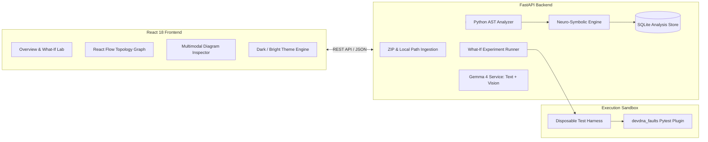

# DevDNA: The AI-Powered Digital Twin for Software Reliability

<div align="center">

[](https://github.com/SUBHA22-CODER/DEVDNA-/actions)
[](https://python.org)
[](https://fastapi.tiangolo.com)
[](https://react.dev)
[](https://tailwindcss.com)
[](https://ai.google.dev/gemma)

**Predict failure blast radius in Python codebases, and prove or disprove the prediction by injecting faults into real pytest test suites.**

[Explore Architecture](docs/ARCHITECTURE.md) • [Algorithm Reference](docs/ALGORITHM.md) • [Security & Isolation](docs/SECURITY.md) • [Contributing](CONTRIBUTING.md)

</div>

---

<div align="center">
  
</div>

---

## 1. The Problem: The Hidden Blast Radius of Modern Codebases

In growing Python systems, answering a deceptively simple question is notoriously difficult:
> *"If our SQLite database, external payment gateway, or background worker fails, which specific HTTP routes crash, which user workflows fail, and will our test suite catch it?"*

* **Architecture diagrams become stale** days after they are drawn.
* **Traditional CI suites test the happy path**—they cannot model cascading failure propagation or single points of failure (SPOFs).
* **AI assistants guess from intuition**, hallucinating components and failure paths without mathematical backing.

---

## 2. The Solution: A Neuro-Symbolic Software Digital Twin

DevDNA constructs a **Neuro-Symbolic Digital Twin** of any Python codebase. Unlike naive AI wrappers that hallucinate call graphs, or purely static tools that cannot reason about semantic runtime behavior, DevDNA fuses both paradigms:

* **The Symbolic Engine (AST MultiDiGraph):** Mathematically maps dependencies, call sites, and exception handlers directly from syntax trees with zero hallucinations.
* **The Neural Engine (Google Gemma 4):** Visually ingests architecture diagrams for drift detection, synthesizes arbitrary failure scenarios from natural language, and reconciles empirical test results. The cascading risk score itself is a deterministic heuristic computed from the dependency graph — no AI model is used for this score, and it is not a failure probability.

```
┌────────────────────────────────────────────────────────────────────────────────────────┐
│                        DevDNA Neuro-Symbolic Digital Twin                              │
├───────────────────────────────┬────────────────────────────────────────────────────────┤
│   SYMBOLIC GRAPH CO-PROCESSOR │ Deterministic AST Parser • Call Sites • NetworkX DAG  │
├───────────────────────────────┼────────────────────────────────────────────────────────┤
│   GEMMA 4 COGNITIVE ENGINE    │ Multimodal Diagram Audit • Arbitrary Chaos Synthesis   │
│                               │ Neural Risk Scoring • Empirical Post-Mortem Analysis   │
├───────────────────────────────┼────────────────────────────────────────────────────────┤
│   EMPIRICAL PYTEST SANDBOX    │ Isolated Subprocess/Docker • Fault Injection Plugin    │
│                               │ JUnit XML Confusion Matrix (TP, FP, TN, FN)           │
└───────────────────────────────┴────────────────────────────────────────────────────────┘
```

---

## 3. Visual Tour & Interface

<div align="center">

### Repository Health & Failure Readiness Dashboard

*Discovers components, analyzes confirmed vs. inferred evidence, flags structural risks, and launches 3-minute hackathon scenarios.*

---

### Interactive Dependency Topology Graph

*Interactive node-and-edge exploration powered by `@xyflow/react` and Dagre layout, with live blast-radius highlighting and AST call-site inspection.*

---

### What-If Lab: Prediction vs. Observed Reality

*Side-by-side verification: baseline test outcomes vs. fault-injected outcomes with automated confusion matrix accuracy scoring.*

---

### Dual Dark & Bright Theming

*Switch instantly between DevDNA's signature dark digital-twin mode and high-contrast bright mode with `⌘+Shift+D`.*

</div>

---

## 4. Key Engineering Capabilities

1. **Gemma 4 Multimodal Visual Architecture Audit:**
   * Uses Google's official Gen AI SDK (`types.Part.from_bytes`) to visually inspect uploaded C4 diagrams, cloud topologies, whiteboard sketches, or terminal error screenshots.
   * Compares the visual diagram against ground-truth AST code to detect architectural drift, unmitigated single points of failure, and implementation gaps.
2. **Gemma 4 Dynamic Chaos Scenario Synthesizer:**
   * Allows developers to express arbitrary failure modes in natural language (e.g., *"Redis connection drop & cache eviction storm"* or *"JWT token expiration cascade"*).
   * Gemma 4 inspects the AST code, identifies target components and exception hierarchies, and generates runtime fault specifications.
3. **Neuro-Symbolic Blast Radius Engine:**
   * Combines dual reverse graph reachability bounds with a deterministic heuristic risk score (0-100; heuristic score, not a failure probability — no AI model is used for this score), with Gemma 4 contributing semantic failure mechanisms and unverified route coverage gap analysis.
   * Differentiates **Definite** paths from **Possible** (conditionally handled) paths.
4. **Empirical What-If Lab (Controlled Fault Injection):**
   * Executes the repository's real `pytest` suite twice: baseline healthy run, then faulted run using the `devdna_faults` pytest plugin.
   * Compares predictions against observed JUnit XML outcomes to compute True Positives, False Positives, True Negatives, and False Negatives with AI discrepancy attribution.
5. **Static AST Ingestion (Zero Code Execution During Ingestion):**
   * Uses Python's native `ast` module to scan functions, routes, database sessions, environment variable reads, and outbound HTTP clients.
   * Every discovered edge carries source file, line number, a redacted code snippet, and evidence classification (`confirmed` vs `inferred`).
6. **Team Findings Workflow:**
   * Assigns finding owners from the repository's `CODEOWNERS` file, falling back to the latest file blame/committer when available.
   * Suppressions require a reason, accountable owner, and future expiry; they remain visible, are audited, and persist across analysis runs.
   * The Findings page filters by owner and suppression status, while Overview compares route changes and growing component blast radii between runs.

---

## 5. Mathematical Foundations & Risk Formula

*Full technical details and proofs are documented in [docs/ALGORITHM.md](docs/ALGORITHM.md).*

DevDNA calculates a structural vulnerability score for every non-test component:

$$\mathbf{Criticality} = 100 \times \Big(0.50 \cdot \text{BlastRadius} \;+\; 0.30 \cdot \text{BetweennessNorm} \;+\; 0.20 \cdot \text{RouteShare}\Big)$$

### Metric Definitions
* **Blast Radius (50%):** $\frac{|\text{Dependents}(v)|}{\max(1, |\text{Non-Test Components}| - 1)}$ (fraction of codebase affected if $v$ fails).
* **Betweenness Norm (30%):** $\frac{B(v)}{\max_u B(u)}$ (Brandes' betweenness centrality on the dependency DAG).
* **Route Share (20%):** $\frac{|\text{Routes Depending on } v|}{|\text{Total Discovered Routes}|}$ (impact on user-facing HTTP endpoints).

### Worked Example
For a component with $16$ of $20$ non-test dependents ($\text{Blast} = 0.80$), normalized betweenness of $0.80$, and impacting $6$ of $6$ routes ($\text{RouteShare} = 1.00$):
$$\mathbf{Score} = 100 \times (0.5 \times 0.80 + 0.3 \times 0.80 + 0.2 \times 1.00) = \mathbf{84.0} \quad \text{(High Risk)}$$

---

## 6. System Architecture



*For complete architectural boundaries and security models, see [docs/ARCHITECTURE.md](docs/ARCHITECTURE.md) and [docs/SECURITY.md](docs/SECURITY.md).*

---

## 7. Technology Stack

| Layer | Technologies | Responsibilities |
| :--- | :--- | :--- |
| **Cognitive AI Core** | Google Gemma 4 26B (`gemma-4-26b-a4b-it`), Google Gen AI SDK | Multimodal visual architecture audits, dynamic chaos scenario synthesis, neuro-symbolic risk evaluation |
| **Backend API** | Python 3.11+, FastAPI, Uvicorn, Pydantic v2, SQLAlchemy, SQLite | High-performance async REST service, analysis persistence, schema validation |
| **Static Analysis** | Python native `ast`, NetworkX | AST visitor traversal, call-site resolution, directed dependency multi-graph |
| **Testing & Faults** | `pytest`, custom `devdna_faults` plugin, JUnit XML parser | Baseline vs. faulted test execution, socket/db/env/dynamic fault interception |
| **Frontend Web** | React 18, Vite, Tailwind CSS 4, Framer Motion, `@xyflow/react` | Interactive graph visualization, multimodal audit drawer, dynamic lab, dual theming |
| **Security & Sandbox** | Multi-pattern regex redaction, path traversal guards, Docker | Strict execution isolation, API key sanitization, environment scrubbing |

---

## 8. Quickstart & Local Setup

### Prerequisites
* **Python:** 3.11 or later
* **Node.js:** 18 or later (npm 9+)
* **Google Gemini API Key:** Required for Gemma 4 multimodal visual audits, dynamic scenario generation, and neuro-symbolic simulation. (An offline graceful fallback is included for local graph browsing).

### 1. Backend Setup
```bash
cd backend
python -m venv .venv

# Activate virtual environment
# Windows (PowerShell):
.\.venv\Scripts\activate
# macOS/Linux:
source .venv/bin/activate

# Install dependencies
pip install -r requirements.txt

# Configure environment
copy .env.example .env    # Windows
# cp .env.example .env    # macOS/Linux
```

*(Optional)* Edit `backend/.env` to configure your `GEMINI_API_KEY`:
```ini
GEMINI_API_KEY=AIzaSy...
GEMMA_MODEL=gemma-4-26b-a4b-it
DEVDNA_ALLOWED_LOCAL_ROOTS=C:\Users\Subha Prasana Parida
```

Launch the backend API:
```bash
uvicorn app.main:app --reload --port 8000
```

Dependencies: `backend/requirements.txt` lists the direct dependencies; `backend/requirements.lock` is the pinned resolution that CI installs (regenerate with `uv pip compile requirements.txt --universal -o requirements.lock` after changing requirements). Backend lint runs `ruff check backend/` (config in `ruff.toml`) in CI.
*API interactive documentation is available at `http://127.0.0.1:8000/docs`.*

Optional hardening (off by default): set `DEVDNA_API_TOKEN` in `backend/.env` to require an `X-DevDNA-Token` header on every `/api` call except `/api/health` (401 `unauthorized` otherwise), and `DEVDNA_RATE_LIMIT_PER_MINUTE` (default 120) for the per-IP request budget (429 `rate_limited`). When the token is set, paste it once in the frontend under Settings → "API access token"; it is stored for the current tab only. Without a token the server logs a startup warning that it is unauthenticated and localhost-only.

### 2. Frontend Setup
For AST complexity scores, start the AST Engine in a separate terminal. The DevDNA API already uses port `8000`, so run the AST Engine on `8001` and point the frontend to it:

```bash
cd ast-engine
python -m pip install -r requirements.txt
uvicorn main:app --reload --port 8001
```

In `frontend/.env.local`, configure:
```ini
VITE_AST_ENGINE_URL=http://127.0.0.1:8001
```

The default AST Engine URL is `http://127.0.0.1:8001`; use `VITE_AST_ENGINE_URL` when it runs elsewhere. The AST Engine permits the local Vite origins by default. For another frontend origin, set `AST_ENGINE_CORS_ORIGINS` on the AST Engine to a comma-separated list of allowed origins. In the Upload ZIP tab, enter a public GitHub repository URL and branch to import and analyze it directly, or provide a ZIP file. In Local folder setup, the optional GitHub URL links that project to its AST complexity score.

The standalone AST endpoint accepts a repository URL directly:
```text
http://127.0.0.1:8001/analyze/repo?github_url=https%3A%2F%2Fgithub.com%2Fowner%2Frepository&branch=main
```
The existing `owner`, `repo`, and `branch` query parameters remain supported.

```bash
cd frontend
npm install
npm run dev
```

Open **`http://localhost:5173`** in your browser.

---

## 9. Automated Test Suites

DevDNA maintains a comprehensive automated test suite across backend algorithms, security boundaries, and UI components:

```bash
# Run backend pytest suite (74 tests)
cd backend && python -m pytest -v

# Run frontend Vitest suite (21 tests)
cd frontend && npm test -- --run

# Compile frontend production bundle
cd frontend && npm run build
```

*Backend tests isolate the environment and mock external GenAI calls to ensure tests never require live credentials.*

---

## 10. Pull Request Impact Check

The static CLI analyzes changed Python files and reports impacted routes, tests predicted to fail, and impacted routes without a statically mapped predicted-failing test. It does not execute repository code or run experiments.

```powershell
cd backend
$report = Join-Path $env:TEMP "devdna-impact.json"
python -m app.cli sample_project --changed-file shoplite/db.py --json-output $report --fail-on-uncovered-route
```

Repeat `--changed-file` for multiple paths, or use `--changed-files-file` with one repository-relative path per line. With `--fail-on-uncovered-route`, the CLI exits with status `1` when an impacted route has no statically mapped predicted-failing test; otherwise it exits `0`. Markdown goes to standard output unless `--markdown-output` is supplied. JSON is written when `--json-output` is supplied.

The [DevDNA PR Impact workflow](.github/workflows/pr-impact.yml) runs for pull requests and creates or updates one report comment. It analyzes the PR source statically and runs no project tests or experiments. Route coverage is heuristic and can miss dynamic or indirect test coverage.

---

## 11. Global Keyboard Shortcuts

| Shortcut | Action |
| :--- | :--- |
| <kbd>⌘</kbd> / <kbd>Ctrl</kbd> + <kbd>K</kbd> or <kbd>/</kbd> | Open New Project Modal (Local folder or ZIP upload) |
| <kbd>⌘</kbd> / <kbd>Ctrl</kbd> + <kbd>J</kbd> | Toggle **Ask DevDNA** AI Assistant Drawer |
| <kbd>⌘</kbd> / <kbd>Ctrl</kbd> + <kbd>Shift</kbd> + <kbd>D</kbd> | Toggle **Dark / Bright Mode** Theme |
| <kbd>Esc</kbd> | Close any active modal or drawer |

---

## 12. Security & Privacy Design

* **Zero Arbitrary Execution:** DevDNA accepts no user-supplied shell commands; all tests execute through a fixed `python -m pytest` command.
* **Scrubbed Environment:** The test harness strips all host environment variables, tokens, and server secrets.
* **Secret Redaction:** Code snippets and stack traces pass through an automated regex redaction engine (`redact.py`) before leaving the backend.
* **Docker Hardening:** Untrusted uploaded code requires Docker (`--network none`, `--read-only`, `--cap-drop ALL`, `no-new-privileges`).

---

## 13. Repository Structure

```
DEVDNA/
├── assets/                     # Genuine screenshots and hero branding
├── docs/                       # Technical specifications & architecture
│   ├── ARCHITECTURE.md         # Subsystems, sequence diagrams, and data flow
│   ├── ALGORITHM.md            # Criticality formula, Dual BFS, confusion matrix
│   └── SECURITY.md             # Threat model, sandboxing, and secret redaction
├── backend/                    # FastAPI Backend Service
│   ├── app/
│   │   ├── cli.py              # Static PR impact report CLI
│   │   ├── ai/                 # Gemma 4 integration (gemma-4-26b-a4b-it, retry loop)
│   │   ├── analyzer/           # Python AST parser, route resolver, redaction
│   │   ├── api/                # REST endpoints (projects, predictions, experiments)
│   │   ├── experiments/        # What-If runner and devdna_faults pytest plugin
│   │   ├── graph/              # NetworkX MultiDiGraph engine and Dual BFS
│   │   ├── models/             # SQLAlchemy database models
│   │   └── services/           # Findings rules, reports, graph serialization
│   ├── tests/                  # 74 automated pytest unit and integration tests
│   ├── sample_project/         # ShopLite reference e-commerce repository
│   └── requirements.txt        # Backend dependencies
├── frontend/                   # React 18 + Vite Web Application
│   ├── src/
│   │   ├── components/         # AIPanel, NewProjectModal, ImpactView, PredictionVsReality
│   │   ├── layouts/            # AppLayout with theme toggle and global shortcuts
│   │   ├── pages/              # Overview, Architecture, What-If Lab, Findings, Reports
│   │   └── index.css           # Tailwind CSS 4 theme tokens & Bright mode overrides
│   └── package.json            # Frontend dependencies
├── .github/                    # CI workflows and issue templates
└── CONTRIBUTING.md             # Contributor setup and coding guidelines
```

---

## 14. License

There is no `LICENSE` file in this repository yet. No license is granted until the repository owner chooses and adds one.
